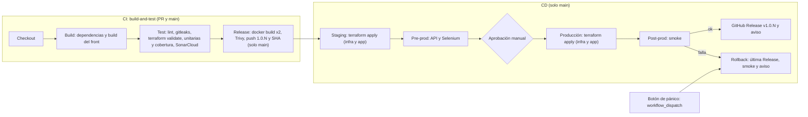

# Plan del proyecto final de CI/CD

- Autor: Sergio Junca
- Fecha: 2026-11-13
- Estado: planeación. No hay código todavía.
- Enunciado: `material-md/Proyecto final - enunciado.md`
- Para decidir en equipo: `decisiones-pipeline.html` (doble clic, funciona sin internet). Al final se descarga un resumen en Markdown.

Regla para todo el plan: cumplir el mínimo del enunciado con lo más simple que se pueda sustentar, y sumar solo lo que deje evidencia visible.

## 1. Resumen

| Tema | Decisión | Por qué |
|---|---|---|
| Orquestador | GitHub Actions | La diapositiva pide mostrar los logs en GitHub Actions y el Taller 3 ya es la base |
| App | Votación en vivo con QR | El público vota desde el celular durante la presentación y la app tiene reglas que se pueden probar |
| Componentes | Web (React + Vite), API (Python) y DynamoDB | Dos servicios detrás de un ALB: la complejidad media se ve en el diagrama |
| Infraestructura | Terraform, ECS Fargate y ALB | Es la del Taller 3 y ya funciona en AWS Academy |
| Ambientes | Staging y producción | Cumplen el mínimo de 2 con el menor costo |
| Ramas | Trunk-based: `main` + ramas cortas con PR y 1 aprobación | La imagen se construye una vez y se promueve |
| Versiones | SHA + `1.0.N` y GitHub Release cuando producción pasa | Trazabilidad y una lista de versiones buenas a las que volver |
| Paso a producción | Aprobación manual (Entrega Continua) | El equipo controla el momento en la demo |
| Rollback | Automático si fallan las smoke + botón de pánico | Es el mínimo del enunciado y usa el mismo camino del deploy |
| 3 modificaciones | gitleaks + Trivy, SemVer con Releases, avisos a Discord | Poco esfuerzo y evidencia visible. Reservas: k6 y el workflow reutilizable |

## 2. CircleCI o GitHub Actions

Respuesta: **GitHub Actions**. Es la opción que más puntos y más tranquilidad da en este curso.

| Criterio | GitHub Actions | CircleCI |
|---|---|---|
| Lo que pide la diapositiva | Literal: "Entrar al pipeline de GitHub Actions y mostrar los logs exitosos" | Hay que justificar el cambio y el profe revisa en otra plataforma |
| Lo visto en clase | Talleres 1, 2 y 3. La Unidad 1 tiene la diapositiva "¿Por qué GitHub Actions? Simplicidad, integración, capa gratuita" | No se vio |
| Reuso | El `ci-cd.yml` del Taller 3 ya tiene 5 de los 7 jobs | Reescribir todo en `.circleci/config.yml` (executors, orbs, workflows) |
| Integración con GitHub | Checks requeridos en el ruleset, Environments con revisores, pestaña Deployments y `GITHUB_TOKEN` para crear Releases | Se conecta con una GitHub App y reporta el estado al PR. La aprobación es un job `type: approval`. Para crear Releases necesita un token aparte |
| Botón de pánico | `workflow_dispatch` con entradas: botón Run workflow | Punto a favor: botón Rollback nativo (rollback pipeline) en el Overview del proyecto, después de configurarlo |
| Secretos | Por repositorio y por ambiente | Contexts por organización y variables por proyecto |
| Costo | Gratis en repositorio público con runners estándar. Los 2.000 minutos y 500 MB del plan Free son para repos privados | Plan Free con créditos mensuales (unos 30.000, cerca de 6.000 minutos en máquina pequeña, según sitios de terceros: verificar en circleci.com/pricing) y 5 usuarios activos |
| Funciones avanzadas | Matrix, workflows reutilizables, caché con `actions/cache` | Punto a favor: caché y paralelismo de pruebas muy buenos, SSH a un job para depurar, Insights |
| Curva en 8 días | Ninguna | Cuenta nueva y sintaxis nueva |

Puntaje (estimación nuestra, de 0 a 10):

| Criterio | Peso | GitHub Actions | CircleCI | Híbrido (CI en GHA, CD en CircleCI) |
|---|---|---|---|---|
| Rúbrica y lo visto en clase | 30% | 10 | 4 | 6 |
| Reuso y tiempo | 25% | 10 | 3 | 4 |
| Integración con GitHub | 15% | 10 | 6 | 5 |
| Rollback y botón de pánico | 10% | 8 | 9 | 9 |
| Costo | 10% | 10 | 7 | 7 |
| Funciones avanzadas | 10% | 6 | 8 | 7 |
| **Total** | | **9,4** | **5,3** | **5,9** |

Cómo ganar puntos con CircleCI sin usarlo: una diapositiva de "alternativas evaluadas" con esta tabla. Muestra criterio sin pagar el costo de migrar. Conviene ser justos: si el curso no pidiera GitHub Actions, CircleCI sería una opción seria por su botón de rollback y su caché.

## 3. La app

Criterios: ajuste a la rúbrica 30%, efecto en la demo 25%, facilidad para vibe-codear y probar 25%, riesgo y costo en AWS Academy 20%.

| Idea | Rúbrica | Demo | Facilidad | Riesgo/costo | Total |
|---|---|---|---|---|---|
| Votación en vivo con QR | 9 | 10 | 8 | 8 | **8,8** |
| Acortador de URLs con QR y estadísticas | 8 | 6 | 9 | 9 | 8,0 |
| Trivia en vivo con ranking | 8 | 10 | 5 | 7 | 7,6 |
| Reservas de salas o turnos | 8 | 4 | 8 | 9 | 7,2 |
| Panel de releases y artefactos (la idea inicial) | 7 | 8 | 6 | 6 | 6,8 |
| App React Native nativa | 4 | 7 | 3 | 3 | 4,3 |

Recomendación: **votación en vivo con QR**.

- El público escanea un QR, vota desde el celular y los resultados se mueven en el proyector. Nadie instala nada.
- Tiene reglas de negocio claras para pruebas serias: voto único, encuesta cerrada, opción inexistente, porcentajes que suman 100.
- Los votos viven en DynamoDB, fuera del contenedor: un deploy o un rollback no los borra.

Por qué no React Native nativo:

- El CD de una app nativa es distribución (tiendas o Expo EAS), no ECS con Terraform. "Deploy App en 2 ambientes" y las smoke post-prod se vuelven difíciles.
- En la demo el público no la puede instalar, y en iPhone hace falta una cuenta de Apple.
- Las pruebas E2E móviles son pesadas para 8 días.

La idea de "ver artefactos" entra en la app ganadora como la sección **Acerca de esta versión**: versión, commit, ambiente, fecha del build y enlaces al run de GitHub Actions y a la Release. Cuesta casi nada y muestra trazabilidad en la demo.

MVP de la app (para vibe-codear después):

- Pantallas:
  - Crear encuesta: pregunta y de 2 a 6 opciones.
  - Encuesta: QR grande, botones para votar y barras que se actualizan cada 2 segundos.
  - Banner fijo con el ambiente (STAGING amarillo, PRODUCCIÓN verde) y la versión.
  - Acerca de esta versión.
- API:
  - `POST /api/polls`: crea la encuesta.
  - `GET /api/polls/{id}`: pregunta, opciones y conteos.
  - `POST /api/polls/{id}/votes`: vota (400 si la opción no existe, 404 si la encuesta no existe, 409 si está cerrada o el voto se repite).
  - `POST /api/polls/{id}/close`: cierra la encuesta con un código de administrador.
  - `GET /api/health`: estado, versión, ambiente y conexión a DynamoDB.
- Fuera del MVP: login, websockets, idiomas y panel de administración. Los resultados se refrescan cada 2 segundos.
- El esquema de datos no cambia entre versiones: así el rollback no rompe los votos guardados.

Guion de la demo:

1. QR de producción en pantalla: "¿GitHub Actions o CircleCI?". El salón vota.
2. Staging (banner amarillo, versión nueva) al lado de producción (banner verde).
3. Botón de pánico lanzado al inicio. Mientras corre, se explican las pruebas.
4. Producción vuelve a la versión anterior: cambia el número en el banner y suena el aviso de Discord. Los votos siguen ahí.
5. Video del rollback automático (smoke en rojo, rollback en verde).

## 4. Arquitectura

```
              Internet (celulares del público, navegador)
                               |
                  ALB del ambiente (HTTP 80)
                 /                          \
        regla /api/*                   resto de rutas
              |                              |
  Target group api (/api/health)    Target group web (/)
              |                              |
  ECS Fargate: servicio api         ECS Fargate: servicio web
  (Python, votaciones-api)          (nginx + build de React, votaciones-web)
              |
  DynamoDB: tabla votaciones-<ambiente>
```

Fuera de cada ambiente:

- GitHub Actions: CI/CD y botón de pánico.
- Docker Hub: imágenes `votaciones-api` y `votaciones-web` con etiquetas `1.0.N` y SHA.
- S3: estado de Terraform, con workspaces `staging` y `production` (igual que el Taller 3).
- CloudWatch Logs: un grupo por servicio y ambiente.
- `LabRole`: rol de las tareas, porque AWS Academy no deja crear roles.
- Discord: avisos de despliegue, fallo y rollback.

El front llama a la API con rutas relativas (`/api/...`) por el mismo ALB. Así la misma imagen web sirve en los dos ambientes, sin CORS y sin configuración por ambiente.

Costo: unos US$3 al día con los dos ambientes encendidos, unos US$23 en una semana. Estimación: la guía del Taller 3 da US$0,05 por hora por ambiente con un servicio, y el segundo servicio suma una tarea Fargate pequeña y una IP pública. El presupuesto de AWS Academy es de US$50 por cuenta: hay que destruir el Taller 3 apenas se entregue.

## 5. Pipeline

### 5.1 Qué corre en cada evento

| Evento | Rama | Jobs | Resultado |
|---|---|---|---|
| `pull_request` | `feature/*` hacia `main` | `build-and-test` | Check verde o rojo en el PR. No publica ni despliega: los demás jobs salen omitidos |
| `push` (merge del PR) | `main` | `build-and-test`, `deploy-staging`, `test-staging`, aprobación, `deploy-production`, `smoke-test-production`, y luego `publish-release` o `rollback-production` | Versión `1.0.N` en los dos ambientes y Release `v1.0.N`, o rollback automático |
| `push` solo de documentación (`**.md`, `docs/**`) | `main` | Ninguno | `paths-ignore`, igual que el Taller 3 |
| `workflow_dispatch` en `panic-rollback.yml` | `main` | `rollback` | El ambiente elegido vuelve a la versión elegida (por defecto, la Release anterior) |

### 5.2 Jobs y herramientas



| Job | Etapa del enunciado | Qué hace | Herramientas |
|---|---|---|---|
| `build-and-test` | CI: Checkout, Build, Test y Release | Instala dependencias y compila el front. Corre lint, gitleaks, `terraform validate`, pruebas unitarias con cobertura de 80% o más y el quality gate. Construye las 2 imágenes, las escanea y, solo en `main`, las publica con las etiquetas `1.0.N` y SHA | `actions/checkout`, `setup-python`, `setup-node`, Black, Flake8, Pylint, ESLint, pytest + moto, Vitest, Terraform, gitleaks, SonarCloud, Docker, Trivy, Docker Hub |
| `deploy-staging` | CD: IaC, Deploy Infra y Deploy App | `terraform apply` en el workspace `staging`: crea o actualiza ALB, ECS y DynamoDB, y despliega la versión. Espera a que `/api/health` responda la versión nueva | Terraform, ECS, `configure-aws-credentials` |
| `test-staging` | CD: Tests pre-prod | Integración de la API y E2E con Selenium contra la URL de staging | pytest + requests, Selenium |
| `deploy-production` | CD: Deploy Infra y Deploy App | Igual que staging, en el workspace `production`, después de la aprobación manual | Terraform, Environments de GitHub |
| `smoke-test-production` | CD: Tests post-prod | Smoke de solo lectura con la versión esperada | pytest + urllib |
| `publish-release` | Versionamiento | Crea la Release `v1.0.N` con notas automáticas y avisa a Discord | `gh release create`, webhook de Discord |
| `rollback-production` | CD: Rollback | Si fallan las smoke o el deploy de producción: despliega la última Release, repite las smoke y avisa | El mismo deploy, Discord |

Los nombres de los 5 primeros jobs son los del Taller 3, así el profe se ubica rápido.

Terraform hace infra y app en un solo `apply`, como en el Taller 3: el ALB, ECS y DynamoDB, y la task definition con la imagen nueva. En el flujograma se muestran como dos pasos (Deploy Infra y Deploy App), y en el log como dos steps: el `apply` y la espera de la versión en `/api/health`.

Los 4 despliegues (staging, producción, rollback automático y botón de pánico) llaman a un solo workflow reutilizable, `deploy.yml` (`workflow_call`), con dos entradas: ambiente y versión. El camino para volver es el mismo camino ya probado para ir.

### 5.3 Rollback

Automático:

1. Fallan `smoke-test-production` o `deploy-production`.
2. `rollback-production` (con `if: failure()`) busca la última GitHub Release. La versión nueva no pasó las smoke, así que todavía no tiene Release: la última es la versión buena anterior.
3. Llama a `deploy.yml` con esa versión, en el workspace `production` de Terraform y en el ambiente de GitHub `production-rollback`, que no tiene revisores.
4. Repite las smoke con la versión restaurada y avisa a Discord con el enlace al run.
5. El run termina en rojo a propósito: hubo un fallo, aunque producción ya esté sana.

Manual (botón de pánico):

1. Actions, "Rollback de emergencia", Run workflow.
2. Entradas: ambiente (`production` o `staging`) y versión. Si la versión va vacía, se usa la Release anterior a la versión que hoy responde `/api/health`.
3. Mismo deploy, mismas smoke y aviso "Rollback manual por <usuario>".

Detalles que hay que cuidar:

- La aprobación protege el avance, no el regreso. Si el rollback usara el ambiente `production`, se quedaría esperando a un revisor. Por eso usa `production-rollback`.
- El rollback revierte la app (la imagen), no la infraestructura. Un cambio de infraestructura malo se revierte con `git revert` y el pipeline normal.
- Si no hay una Release previa, el rollback avisa y falla. Antes de la demo debe haber al menos 2 Releases.
- El circuit breaker de ECS sigue activo: si la versión nueva no arranca, ECS vuelve sola a la anterior, el `apply` falla y el job de rollback deja todo en la última Release.
- Solo quien tiene permiso de escritura en el repo ve el botón Run workflow. GitHub registra quién lo usó.

## 6. Pruebas

| Prueba | Dónde corre | Herramienta | Qué valida | Por qué ahí |
|---|---|---|---|---|
| Formato y lint | CI, en cada PR y push | Black, Flake8, Pylint, ESLint | Estilo y errores comunes | Tarda segundos: falla rápido |
| Secretos | CI | gitleaks | Que no haya llaves ni tokens en el código ni en el historial | Antes de publicar cualquier cosa |
| IaC | CI | `terraform fmt -check` y `terraform validate` | Que la infraestructura esté bien escrita | Antes de tocar AWS, sin credenciales |
| Unitarias y cobertura | CI | pytest + pytest-cov + moto (API), Vitest (web). Umbral de 80% | Validar la encuesta, voto único, encuesta cerrada, opción inexistente, porcentajes | Rápidas y aisladas, sin AWS |
| Calidad (SAST) | CI | SonarCloud con quality gate | Bugs, vulnerabilidades, duplicación y cobertura del código nuevo | El gate bloquea el PR |
| Vulnerabilidades de la imagen | CI, después del `docker build` | Trivy | CVE críticos en la imagen base y en las dependencias | No publicar un artefacto vulnerable |
| Integración de la API | Staging (pre-prod) | pytest + requests | La API real con DynamoDB real: crear, votar y los errores 400, 404 y 409 | Primer ambiente con infraestructura real |
| Aceptación E2E | Staging (pre-prod) | Selenium (Chrome sin ventana) | El flujo del usuario: crear encuesta, votar y ver el resultado | Valida el sistema completo antes de pedir la aprobación |
| Humo (smoke) | Producción (post-prod) | pytest + urllib | La web carga, `/api/health` responde `ok` con la versión esperada y la base conectada. Solo lectura | Segundos y sin ensuciar datos reales. Si falla, hay rollback |
| Humo después del rollback | Producción | Las mismas smoke | Que la versión restaurada responde | Cierra el ciclo del rollback |
| Health check continuo | Staging y producción | ALB + circuit breaker de ECS | Que cada tarea responde | Si la versión nueva no arranca, ECS vuelve sola a la anterior |

## 7. Las tres modificaciones

| # | Modificación | Qué cambia frente al Taller 3 | Evidencia para la presentación | Esfuerzo |
|---|---|---|---|---|
| 1 | DevSecOps: gitleaks + Trivy | El CI busca secretos en el código y en el historial, y escanea las 2 imágenes. Falla si hay vulnerabilidades críticas | Logs de los pasos y pestaña Security. Mejor aún: un run en rojo por una vulnerabilidad y el PR que la arregla | Bajo |
| 2 | SemVer + GitHub Releases | Cada versión que pasa producción queda como Release `v1.0.N` con notas automáticas. El rollback vuelve a esas Releases | Página Releases, versión en el banner de la app y en `/api/health` | Medio |
| 3 | Avisos a Discord | Mensaje al desplegar, al fallar y al hacer rollback, con enlace al run | Canal con los mensajes. En vivo suena el celular | Bajo |
| Reserva | Prueba de carga con k6 en staging | Umbral de p95 y de tasa de error antes de pedir la aprobación | Resumen de k6 en el log | Medio |
| Reserva | Workflow reutilizable `deploy.yml` | Staging, producción y los 2 rollbacks usan el mismo código | El archivo y el grafo del run | Ya está en el diseño |

Si sobra un día, hacer k6: da margen si el profe no acepta alguna. La arquitectura de 2 servicios con DynamoDB también es nueva frente al Taller 3, pero es parte del requisito de 2 componentes: no la contamos como modificación.

## 8. Decisiones tomadas y alternativas descartadas

1. GitHub Actions. Descartadas: CircleCI (la diapositiva pide GitHub Actions) y el híbrido (doble configuración y doble manejo de secretos).
2. El Taller 3 como base: Terraform, ECS, ALB, staging, producción, aprobación y smoke. Descartado: empezar de cero.
3. Votación en vivo con QR. Descartadas: React Native nativo (su CD no encaja con ECS y el público no la puede instalar) y el panel de artefactos como app principal (depende de la API de GitHub y de un token). El panel queda como la sección "Acerca de esta versión".
4. Monorepo con `web/`, `api/`, `infra/` y `tests/`. Descartado: un repo por componente (dos pipelines y la evidencia repartida).
5. Web en React + Vite, API en Python y DynamoDB, como 2 servicios ECS detrás de 1 ALB. Descartados: RDS (lento de crear y más caro), datos en memoria (cada deploy borra los votos) y el front en S3 (CORS y un rollback distinto).
6. Dos ambientes. Descartados: tres (más costo, no suma frente al mínimo) y ambientes temporales por PR (sobreingeniería).
7. Trunk-based. Descartado: GitFlow con `develop` hacia staging y `main` hacia producción, porque el merge a `main` reconstruye la imagen y producción recibiría un artefacto que no se probó en staging.
8. SemVer `1.0.N` + Releases. Descartados: solo SHA (no se lee en la demo y no deja una lista de versiones buenas) y release-please (exige disciplina en cada mensaje de commit).
9. Aprobación manual antes de producción. Descartado: despliegue continuo sin aprobación, porque en la demo no se controlaría el momento.
10. Rollback con el mismo deploy y la imagen anterior, en un ambiente sin revisores. Descartados: `aws ecs update-service` (deja a Terraform desalineado) y blue/green con CodeDeploy (mucho trabajo y roles que AWS Academy limita).
11. Botón de pánico con `workflow_dispatch`. Descartado: un botón dentro de la app (obliga a guardar un token de GitHub en la app).
12. Llaves de AWS Academy en GitHub Secrets, como en el Taller 3. Lo ideal sería OIDC, pero AWS Academy no deja crear roles. Sirve como aprendizaje en la presentación.
13. Pruebas de la base en CI con moto. Descartado: DynamoDB Local en Docker (más lento) y la tabla real desde CI (ataría el CI a credenciales que vencen).

## 9. Rúbrica y evidencia

| # | Punto de la presentación | Evidencia que vamos a mostrar |
|---|---|---|
| 1 | Artefacto | Demo de la app, sus 3 piezas y por qué es complejidad media |
| 2 | Estrategia de ramas | Diagrama de trunk-based, ruleset `proteger-main` y un PR aprobado |
| 3 | Diseño del pipeline | Flujograma con cada paso y su herramienta (HTML con play por pasos, como el del Taller 2) |
| 4 | Versionamiento en el pipeline | Tabla de la sección 5.1 y la página de Releases |
| 5 | Arquitectura | Diagrama con logos: ALB, 2 servicios ECS, DynamoDB, CloudWatch, S3 y Docker Hub |
| 6 | Pruebas | Tabla de la sección 6 y los reportes (cobertura, pytest-html y SonarCloud) |
| 7 | Pipeline exitoso | Abrir el run del merge en GitHub Actions con todos los jobs en verde |
| 8 | 3 modificaciones | Logs de gitleaks y Trivy, la página de Releases y los mensajes de Discord |
| 9 | App en cada ambiente | Abrir staging (banner amarillo) y producción (banner verde) con su versión |
| 10 | Desafíos y aprendizajes | Credenciales que vencen cada 4 horas, el rollback que esperaba aprobación, OIDC imposible en AWS Academy |

## 10. Cronograma y roles

| Día | Qué | Resultado |
|---|---|---|
| Vie 13 nov | Plan y HTML de decisiones | Estos archivos |
| Sáb 14 nov | Clase. Entregar el Taller 2. Reunión de 30 minutos para llenar el HTML y cerrar decisiones. Preguntas al profe (sección 12) | Decisiones cerradas |
| Dom 15 nov | Entregar el Taller 3 (fecha tentativa). Crear el repo. Vibe-codear el MVP en local con Docker | App corriendo en local con pruebas unitarias |
| Lun 16 nov | `build-and-test` completo en PR. Proteger `main` | CI en verde |
| Mar 17 nov | Primero probar que `LabRole` escribe en DynamoDB. Luego Terraform de 2 servicios, staging, producción, pruebas pre-prod y smoke | CD en verde hasta producción |
| Mié 18 nov | Rollback automático y botón de pánico. Romper una versión a propósito y guardar los runs | Evidencia del rollback |
| Jue 19 nov | Releases, Discord y k6 si sobra tiempo. README con evidencias | Las 3 modificaciones con evidencia |
| Vie 20 nov | Flujograma, arquitectura, diapositivas, video de respaldo y ensayo. Clase a las 6 pm | Presentación lista |
| Sáb 21 nov | Una hora antes: renovar las credenciales de AWS en los secretos y probar los dos ambientes y el QR. Exponer. Después: `terraform destroy` | Entregado |

El foro de DORA, IA y GenAI (15%, individual) también vence el 21 nov.

Roles:

- Propietario del repo (sus cuentas de AWS Academy, Docker Hub y SonarCloud): Terraform, deploy, rollback y botón de pánico.
- Integrante 2: API, pruebas unitarias y de integración, Releases.
- Integrante 3: web, Selenium, Discord, flujograma y diagrama de arquitectura.
- Todos: revisan PRs (el ruleset pide 1 aprobación) y cada uno expone su parte.

## 11. Riesgos

| Riesgo | Qué pasa | Qué hacemos |
|---|---|---|
| Las credenciales de AWS Academy vencen cada 4 horas | Fallan el deploy, la aprobación o el rollback | Renovar los 3 secretos antes de cada corrida importante y una hora antes de exponer |
| Presupuesto de US$50 por cuenta | Si se acaba, la cuenta se suspende y se pierde todo | Destruir el Taller 3 al entregarlo, mirar el presupuesto cada día y destruir todo al final |
| `LabRole` sin permisos sobre DynamoDB | La API no guarda | Probarlo el martes antes que nada. Plan B: datos en memoria con 1 tarea, explicado como limitación |
| El rollback espera aprobación | El rollback automático no corre | Ambiente `production-rollback` sin revisores |
| El pipeline tarda varios minutos | Se acaba el tiempo de la demo | Video del rollback automático y botón de pánico lanzado al inicio |
| Selenium inestable | Falsos rojos | Esperas explícitas y un reintento |
| No hay Release previa | El rollback no tiene a dónde volver | Tener al menos 2 Releases antes de exponer |
| La URL del ALB es HTTP | Algunos celulares avisan "no seguro" | Avisar al público y probar con Android y con iPhone |
| El estado de Terraform queda bloqueado | No se puede desplegar | `concurrency` sin cancelar, como el Taller 3. `terraform force-unlock` como último recurso |

## 12. Preguntas para el profe

1. ¿La presentación es el sábado 21 de noviembre? La diapositiva dice 25 de abril, que es de la cohorte anterior. ¿Cuánto dura cada presentación?
2. ¿Web + API + base de datos cuenta como complejidad media, al menos dos componentes?
3. ¿Sirven estas tres modificaciones: DevSecOps (gitleaks + Trivy), SemVer con Releases y avisos a Discord? ¿Cuentan aunque el tema se haya visto en teoría, si no se implementó en los talleres?
4. ¿Se sube algo a Interactiva además de la presentación, por ejemplo la URL del repo?
5. ¿Podemos usar la cuenta de AWS Academy del propietario del Taller 3?

## 13. Puntos extra baratos

- Seguir en las diapositivas el orden exacto de los 10 puntos: el profe califica con esa lista.
- Una diapositiva con métricas DORA reales del proyecto, sacadas de los runs con `gh run list`: despliegues por día, tiempo del commit a producción, tasa de fallos y tiempo de recuperación del rollback. Conecta con el foro y con la bibliografía del curso (Accelerate). Solo con datos reales.
- Un resumen en cada run (`$GITHUB_STEP_SUMMARY`) con la versión, las URLs y los resultados: la evidencia se lee sola.
- La pregunta de la encuesta en vivo puede ser del curso: "¿GitHub Actions o CircleCI?".

## Fuentes

- Guía del Taller 3: https://github.com/danielr9911/cicd-workshops/blob/main/Taller-Entregable3.md
- Plan de evaluación del curso: `material-md/Unidad 1 - CICD 20262.md`
- Facturación de GitHub Actions: https://docs.github.com/en/billing/managing-billing-for-github-actions/about-billing-for-github-actions
- Cambios de precios de GitHub Actions en 2026: https://resources.github.com/actions/2026-pricing-changes-for-github-actions/
- Rollback en CircleCI: https://circleci.com/docs/guides/deploy/rollback-a-deployment/ y https://circleci.com/docs/deploy/rollback-a-project-using-the-rollback-pipeline
- Plan Free de CircleCI (sitio de terceros; verificar en https://circleci.com/pricing): https://costbench.com/software/developer-tools/circleci/free-plan/
